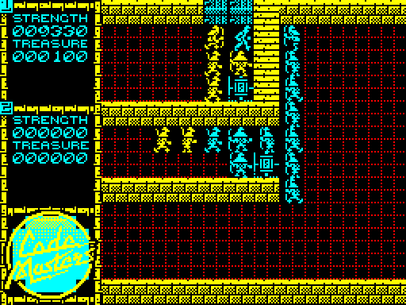
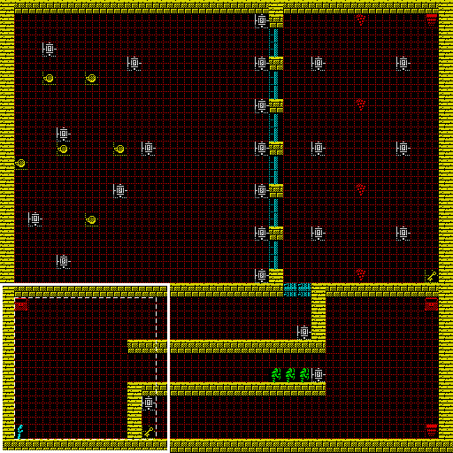
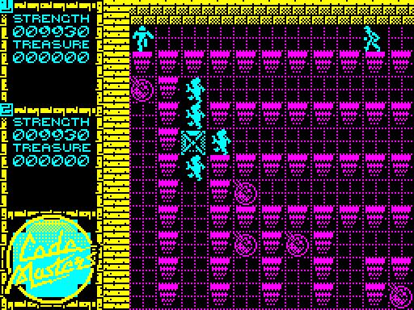
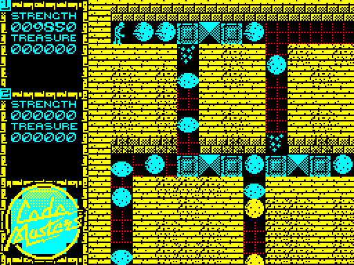
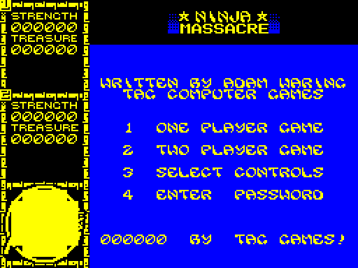

# How Ninja Massacre works

A tour of Codemasters' *Ninja Massacre* (ZX Spectrum, 1989) and of this
BBC Micro port: what the game is, how the original is put together, what
the BBC does differently, and how the port is checked against the
original.

The detail behind it is in [research.md](research.md) and
[research/](research/) (the original, from its disassembly),
[decisions.md](decisions.md) (every place the port differs, numbered) and
[journal.md](journal.md) (the story). The original's routines are named
as `disasm/*.ctl` names them, with an address where it helps; names in
`code font` are the port's labels in `src/`.

## The game

Up to two ninjas fight their way through 50 levels, seen from above. It's
a Gauntlet clone: find the exit, hit or throw stars at everything on the
way, pick up treasure and food, and keep your strength above zero.

The screen is the Spectrum's 256 x 192. The left 64 pixels are the panel
(each player's strength, treasure, keys and smart bombs), and the other
192 x 192 is a view onto the level.

### The level and the view

A level is a map of 32 x 32 tiles, each tile 16 x 16 pixels, so the whole
level is 512 pixels square. The view shows 12 x 12 tiles of it. Each level
has a start, which sets both ninjas' position and the first view.

The view doesn't follow a ninja smoothly. A ninja can walk anywhere in
the dashed area; a step out of it makes the whole view slide eight tiles
that way, a tile at a time, while the game waits. The slide stops at the
map's edge, and in a two-player game it goes only as far as keeps the
other ninja in view, so one player can't drag the other off screen. If
that's no distance at all, the mover just can't go on that way.

### Two players

Both ninjas play at once, player 1 in cyan and player 2 in green, on the
same keyboard. They can't walk through each other: walking into the other
ninja shoves it a step. A level ends when neither is left in it, and only
those who left by the exit go on to the next. A ninja whose strength runs
out is out of the game, and the other plays on alone.

### Things in a level

Everything in a level is a tile: walls, floor, items and the exits.

- **Keys** open **doors** (a whole run of door tiles goes for one key)
  and **locked chests**, which hold a chest of treasure, tea, a smart bomb
  or, now and then, a monster that can't be killed.
- **Chests** are treasure. **Grapes, tea and rice** are strength.
- **Scrolls** are the magic: smart bombs, carried and used with the magic
  key.
- A **death star** makes a ninja's stars stronger, a **ball** makes them
  bounce, a **shield** turns away a quarter of the strength changes, an
  **idol** makes the monsters run away for a while, a **heart** makes the
  ninja invulnerable for a while (it blinks), a **clock** freezes every
  monster, and a **horseshoe** lets a ninja's stars freeze the other
  player.
- **Rocks** can be pushed, **teleporters** send a ninja to another
  teleporter in view, a **switch** removes one kind of wall everywhere,
  and **one-way tiles** let a ninja through and then turn into a wall
  behind it.
- Some walls **crumble** when stars hit them, and the **creeper** (green
  on magenta, flashing) slowly spreads into empty floor wherever it is,
  on screen or not.
- The **exit** is a staircase.

Picking something up isn't instant. A ninja walking into anything is
blocked, and only every tenth contact (by either ninja, with anything,
walls included) actually does something. It's why an item takes a pass or
two of pushing, and why punching a monster lands a hit every few passes.

### Monsters and trap doors

There are eight kinds of monster ("nasties", in the loading screen's
legend), and each has a health of 0 to 3, shown by its colour. They chase
the nearer ninja and hurt it by walking into it: the stronger the kind,
the more strength each hit takes. A ninja kills one by walking into it
(every punch pays treasure) or by throwing stars at it.

Monsters come out of **trap doors**, which sit in the map and, while
they're in or near the view, now and then put out a sparkle that turns
into a monster of the trap door's kind. A trap door can be destroyed by
hand or with stars. One kind, the **hell hole**, can't be destroyed, makes
monsters of any kind on every visit, and kills a ninja that walks into it.

### Stars

Each ninja has one throwing star at a time. It flies a cell (8 pixels) a
pass, changing colour every cell, until it hits something, goes out of
view or, with balls collected, bounces. A star kills monsters, wears down
trap doors and crumbling walls, destroys tea and rocks, sets off a scroll
it hits as a smart bomb, and goes through a teleporter. On the other
ninja it does no harm, but a thrower holding the horseshoe freezes it
(or unfreezes it).

### The smart bomb

The magic key spends a scroll. Usually it clears every monster and trap
door in the view and a tile around it (but the hell holes), with no
reward. Rarely (a random number decides) it does something else to the
whole map instead: every monster becomes a chest of treasure and every
trap door a cup of tea. Either way the floor flashes eight times, with
a sound. Holding the key spends one a pass.

### Strength, treasure, passwords and the clock

Strength starts at 1,000 and drains slowly as well as with every hit. The
panel shows strength and treasure with a sixth digit, a 0 painted on the
loading screen, so they look ten times as large. Every fifth level up to
40 has a password, shown on its "LEVEL nn" screen, which the menu takes to
start there. After level 50 comes "WELL DONE YOUNG MAN!", the strength
left is counted into treasure, and the game ends with both ninjas dying
of the strength they no longer have.

The game also helps a stuck player out. A timer counts down on the
status tick (every 25 passes), and when it runs out every key, door and
locked chest in the map vanishes. After a few such periods, every wall
round the edge of the map becomes an exit. Taking treasure resets the
timer; nothing else does, not even a new level or a new game.

## How the original is built

The game's code is about 7K, all of it in one block above the levels, with
the graphics after it (research.md, "The memory map"). It's an easy kind
of Spectrum game to port: everything is drawn on the 8 x 8 character grid,
so there is no colour clash, no masking and no pixel shifting.

### Everything lives in the map

The level being played is one 32 x 32 byte array, a byte a tile, and it
holds more than the scenery. Its codes (research/monsters.md, section 1):

| Codes | What |
|---|---|
| `&00` | floor: the only thing a ninja can walk on |
| `&01`-`&1F` | walls, items, doors, chests, the creeper, the exit |
| `&20`-`&3F` | trap doors: the kind in the low three bits, its health above |
| `&40`-`&5F` | a sparkle, becoming a monster |
| `&71`, `&72` | player 1, player 2 |
| `&7F` | the rest of a monster's cells |
| `&80`-`&FF` | a monster: its kind, its health, and where it sits in its tile |

Ninjas and monsters move a character (half a tile) at a time, so they can
straddle tiles; each is written into every tile it covers. That's how
everything finds everything else: a star, a monster or a ninja looks at
the map, never at the screen. A monster's code even carries its own
state: its kind, its health and its offset within the tile.

The graphics are 192 blocks of 16 x 16 pixels at one bit a pixel: the 40
tiles, eight frames of the sparkle, and nine sets of sixteen
character frames (the ninja's and the eight monsters', eight directions
of two frames each). Each tile type has one Spectrum attribute: an ink on
black paper (the creeper aside), the floor's ink changing with the level.

The levels are packed as runs, a level after another. The decoder adds
the border walls, and a pass after it gives each trap door and monster a
random health and marks the start (research/core.md, section 4).

### The pass

The main loop (`&C014`) is one *pass*: player 1, player 2, the stars, the
monsters, the status tick, the timers, the creeper, and a check for the
level's end. Nothing waits for the frame. A pass takes as long as its code
does, and the ninjas, stars and monsters move by passes: a ninja steps a
cell every two passes, a star a cell every pass.

Some things stop the loop inside a pass: a slide of the view, a smart
bomb, and every sound effect, since the beeper's loops take the processor
while they play.

### The monsters' scan

The monsters aren't in a list. Each pass, `MonsterScan` (`&CE77`) visits a
quarter of the tiles in the view and a tile round it, in a checkerboard
pattern that covers every tile once in four passes. A monster found there
takes its turn; a trap door may spawn; a sparkle may become a monster. The
checkerboard's shift between rows means a monster that has just moved
can't be visited again in the same pass.

A monster steps only on alternate sweeps, so once every eight passes,
diagonally towards its target if it can, else along one axis. Each of its
tries that lands on a ninja is a hit, which is why a monster right beside
a ninja hurts twice as much as one diagonally off.

For every tile with no monster, the scan burns a fixed delay. That keeps a
pass from speeding up when the view is empty, and is a large part of every
pass's time (decision 12 has the measurement).

### Random numbers

The original takes its random numbers from the Z80's R register, which
counts instruction fetches. They decide the trap doors' and monsters'
health at the start, which trap doors spawn and when, a hell hole's
monsters, what's in a locked chest, which teleporter, the shield's
quarter, the smart bomb's rare outcome, and the shape of two noises.

### Sound and music

The 48K and the 128K load the same tape, and the game's code is the same
on both. The sound effects are the beeper's on both: a chirp for a throw,
a click for a step, noise when a monster is hit or hits a ninja, two
sweeps for the smart bomb. Each blocks the game while it plays.

The 128K adds David Whittaker's music on the AY chip: his driver and
seven songs in a memory bank of their own, played once a frame from the
interrupt. Song 0 is the main theme, played all through the levels; the
others are jingles (the start of a game, a ninja leaving a level, a
death). research/music-driver.md takes the driver apart.

The 128K version is the port's specification (decision 2).

## On the BBC

The port is a transcription: each of the original's routines is
rewritten in 6502, reading beside the Z80 it came from. Two choices make
that easier. The Z80's registers are kept in zero page by name (`rb`,
`rc`, `rd`, `re`, `rh`, `rl`: `regs.6502`), so a routine that passes a
position in BC still does; and the original's variables are kept in its
own layout (`vars_ba`, `vars_ff`, decision 10), because it reaches a
player's variables by offset from the player's record and keeps tables
among them. The two ninjas' code, which the original has twice, is
written once, for the player in `pl` (`player.6502`).

### The screen

The screen is MODE 1's pixels with the CRTC narrowed to 256 x 192: the
Spectrum's geometry exactly, at the top of RAM (decision 1). MODE 1 has
four colours to MODE 2's eight, but twice the horizontal detail, and the
look of this game is fine detail: the bricks, the ninjas, the font, which
MODE 2 would halve.

The graphics stay one bit a pixel, as the original keeps them. Drawing a
block turns each byte of eight pixels into two MODE 1 bytes through two
tables made at start-up (`hi_nibble` and `lo_nibble`),
then masks them with the colour the attribute's ink maps to
(`ink_mask`). Tiles and characters are drawn opaque, as the original
draws them (`draw_tile`, `draw_sprite`).

The original prints text into cells and leaves their colours as they
were, so a cell's colour is whatever set it last. The port keeps a copy
of the Spectrum's attributes (`attrs`) and draws in the colours they give
(decision 8).

### Four colours

Each level's palette is black, yellow, the level's floor colour and cyan
(`level_colours`, decision 5). The walls are yellow, the floor changes
colour by level as in the original, and everything else (white, green,
blue, red and magenta things that aren't the floor) is cyan.

That costs something. Player 2's green is cyan too unless the floor is
green; the items lose their colours; the creeper's flash isn't shown; and
the menu's flash (decision 21) takes two of the four colours, so the
panel and the title flash with it. The checks compare the screens in
this mapping (`tools/viewcmp.py`).

### Memory

There are three places to put things (the build's `PRINT`s say how much
room each has left).

- **Main RAM**, from `CODE_BASE` up to the screen: the code that runs
  every pass (the players, touching, the monsters, the stars, drawing, the
  status, the shifts), the music's driver, the 192 blocks and the
  original's variable blocks.
- **OS workspace** below that (decision 11). Once the game owns the
  interrupts and makes no OS calls, the language's pages and the sound and
  buffer pages are free: they hold the map, the attributes, the drawing's
  tables and the music's state.
- **A 16K sideways RAM bank** (decisions 6 and 20), filled from the file
  `NDATA` by the loader `NLOAD`, and paged in for good: the levels, the
  songs, the panel, the font, and the code that needn't be in main RAM
  (the level's set-up, text, the colours, the front end), which runs from
  there as fast as from main RAM.

So the game needs 16K of sideways RAM, or a Master.

The original's 50 levels, run-length packed, wouldn't fit. The port keeps
each as the 32 x 32 map the original's decoder makes, packed with ZX02,
and unpacks it straight into the map (`level_load`, decision 4).
`tools/mklevels.py` makes them with a transcription of the original's
decoder, which `tools/levelcheck.py` checks against the original's own,
level by level.

One byte past the map is the original's: its monster scan, with the view
at the bottom right, reads a tile beyond the map, which on the Spectrum
is the first byte of the game's code, and that byte happens to be a trap
door. The port keeps it there (`map_tail`, decision 23), so the game
spawns from it as the original does.

### The pass clock

The original's pace comes from its code, padded by the monsters' scan. A
6502 would run the same work at a different speed, so the port keeps the
decision, a steady pace, and not the padding (decision 12). The System
VIA's first timer runs free at the original's median pass length
(`PASS_TICK`), its interrupt counts ticks in `passes`, and the main loop
(`main_loop`) waits for the next tick before each pass. The scan's delay
isn't transcribed.

Things that stop the original inside a pass still do here, each for its
own time: the slide, the sounds, the level's title screen (a wait for as
many frames as the original's busy loop took: decision 9).

### Random numbers

A 6502 has no R register, and R's value depends on the exact count of
instructions run, which a port can't reproduce. The port draws its
numbers from an 8-bit generator instead (`random`, decision 7): shift the
byte left, and if a bit falls off the top, EOR it with `&1D`. That steps
through all 255 non-zero bytes before it repeats. It draws one wherever
the original reads R.

The menu seeds the generator from the VSync count as a player picks a
game, so how long they spent at the menu varies the game's numbers, as
R's timing does on the Spectrum. After that the numbers depend only on
how many have been drawn. The test disc goes straight into a game with
a fixed seed, so a check plays the same game every time.

The two noises take their numbers from a second generator of the same
kind (`noise_random`), with its own state, so playing a sound never moves
the game's numbers. It's seeded at start-up as well: a generator left at
0 stays at 0, and the noises would be silent.

### The scroll

The slide moves the playfield a tile at a time, as the original does
(`scroll_up` and its kin in `player.6502`, the block moves in
`shift.6502`), then draws the strip that came into view. MODE 1 has twice
the Spectrum's bytes for the same picture, and the Spectrum's LDIR is hard
to beat, so the block moves copy sixteen bytes at a time through
addresses written into the loop. The slide takes longer than the
original's (decision 22 has the measurements). Hardware scrolling can't
help: the CRTC splits the screen into bands of rows, so the panel down
the left would move with the playfield.

The same decision made the panel quicker: the original reprints the
panel's figures and icons on every touch, cheap on the Spectrum and not
here, so the port remembers what each panel cell shows (`panel_shown`) and
skips a character that's already there.

### The music

The music is Whittaker's driver transcribed to 6502 (`music.6502`,
decision 14), playing the original's song data, which `tools/mkmusic.py`
takes from the 128K's bank. The driver's state is the original's, voice
for voice, down to its shadow AY registers. The VSync interrupt runs a
frame of it (`music_tick`), then `mu_output` converts the AY registers
for the SN76489 and writes those that changed:

- **Pitch**: the AY's period times 1155/1024, which the SN plays a
  quarter of a cent sharp, with only adds and shifts (decision 15).
- **Volume**: each AY step one of the SN's 2dB steps, as the music
  conversion this project began with does (decision 16).
- **Noise**: the AY mixes one noise generator into any voice; the SN has
  a noise channel of its own, played as loud as the loudest voice the
  noise is mixed into (decision 17).
- **Bass**: the SN can't play below about 122Hz, and the main theme's bass
  is below that nearly all the time. Those notes are played at their
  pitch as the music conversion's own player plays them: the channel's
  tone too high to hear, and a VIA timer switching its volume on and off
  every half-cycle, one timer a channel (`bass.6502`, decision 18).

`tools/mkmusic.py` finds the song data by playing every song and noting
what the driver reads, rather than by walking the bytes: the jingles'
voices have no ends of their own and run on into the next song's data.

### Sound effects

The beeper's effects are played on the SN76489 (`sound.6502`, decision
19), each as long as the original's, with the game waiting as it did.
The chirp and the smart bomb's sweeps are a tone at each half-cycle's
pitch, the step's click a step of a channel's volume, and the noises white
noise switched on and off in the original's segments, timed by the User
VIA's second timer. While an effect plays it holds `mu_busy`, which keeps
the music's frame off the chip; the music writes its whole state again
afterwards. The bass's edges go on, each a single byte, but channel 1's,
whose channel and timer the effect takes. A tone's write is two bytes,
and an edge's landing between would send the second to the wrong
register, so those keep interrupts off between them.

### The front end and the keys

The menu, passwords, redefining the keys, game over, the high score and
its name, and the game's end are transcribed (`menu.6502`). The original
redefines keys by rewriting its own key-reading code; the port keeps a
table of keys per player (decision 13). The original's keys are the
defaults where the BBC has them, with RETURN and SHIFT for the Spectrum's
ENTER and CAPS SHIFT, and CTRL with SHIFT for EXTEND MODE.

Decision 21 lists where the front end differs. The loading
screen's legend of items and nasties, which the original keeps as its
attract screen, isn't kept, so the menu comes straight up. The menu's
flash swaps two colours in the palette every few frames, where the
original rewrites the attributes twice a frame and shows both colours at
once in rolling bands. The Kempston options say KEMPSTON SELECTED and
leave the keys as they were.

## How the port is checked

The rule is "measure, don't recall", and the original is the oracle.

### The Spectrum, headless

The original runs on SkoolKit's Z80 simulator (`tools/zx.py`), driven by
the same kind of key script as the port in jsbeeb (`tools/play.mjs`).
`make disasm` builds a labelled disassembly from `disasm/*.ctl`, and
every routine the port transcribes has a name there.

The random numbers would part the two at once, so for the checks
`tools/zx.py`'s `share_random` makes the original use the port's
generator too (decision 7). It turns each `LD A,R` into a call to the
same generator, placed in the publisher's mastering code, which never
runs. The noises' numbers stay out of the shared stream, as they do in
the port.

### The views

`make views` draws every level's first view on both machines
(`tools/zxviews.py` and `tools/viewcheck.mjs`) and `tools/viewcmp.py`
compares every pixel of the playfield, in the colours the port maps the
Spectrum's to. All 50 levels match.

### Pass by pass

`make passes` replays the scenarios in `tests/scenarios.txt` on both
machines: keys held over ranges of passes, from a level, with one player
or two. `tools/passlog.py` logs the original at the top of each pass,
`tools/passlog.mjs` the port at `pass_top`, and `tools/passcmp.py`
compares both variable blocks, the whole map (which holds the ninjas and
the monsters) and, every 50 passes, the screen. Keeping the original's
variable layout is what makes the comparison straightforward: the same
addresses mean the same things on both.

Among the scenarios are coverage runs, taken from random games on the
original and chosen so that every touch, star and bomb handler runs at
least three times.

The screens are in the comparison because a bug once got past everything
else: a change to the printing broke the panel's icons while every
variable still matched.

### The fuzzer

`make fuzz` (`tools/fuzz.py`) writes random scenarios: a random level, one
or two players, random keys for random stretches, sometimes scrolls in
hand so the smart bomb goes off. They run through the same comparison.
It found differences no scenario reached, mostly where the original does
something odd that the transcription had smoothed over:

- After a kill, the original's touch loop carries on from whatever the
  drawing left in BC, so the cells it touches next are odd ones. The port
  leaves `rb` and `rc` the same way.
- A hell hole's sparkle reads its code from the Z80's alternate
  accumulator, which on one path still holds the random number.
- With the view at the bottom right, the scan reads past the map
  (`map_tail`, above).

A scenario that finds a difference is copied into `tests/scenarios.txt` as
it is, so it's checked from then on.

### The music

`make music` plays every song on a test build of the port, frame by
frame, and compares each frame's AY registers with
`tools/music/dw_decode.py`, a Python model of the driver that matches the
captures from the real game; it compares the bytes sent to the SN76489
with a model of the conversion (`tools/musicmodel.py`) too. All seven
songs match every frame.

Then it plays the game until each channel has bass, and measures that
channel's edges in jsbeeb's capture of the chip's writes: they must
switch between the note's volume and silence, a half-cycle apart.

`make check` runs the lot: the build, the views, the disassembly, the
music and the scenarios. `make check MODEL=Master` runs it on a Master
128, and CI runs both.

## What's open

The open questions are [GitHub issues](https://github.com/mattgodbolt/nm/issues):
mostly choices to make with the two games side by side (the colours,
the slide, the sound, the keys), and real hardware, on which nothing has
run yet.
